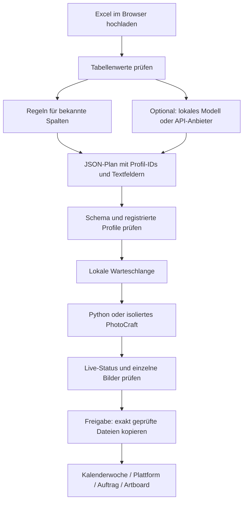

# PSD Headless

[](https://github.com/Bonesisis/PSD_Headless/actions/workflows/ci.yml)

Lokale PSD-Textverarbeitung mit Batch-CLI, Browseroberfläche und HTTP-API.
Windows, macOS und Linux · Python 3.11–3.13 · MIT · Luca-Gene Bonzel

## Neuer Controller: Excel, unabhängige KI und PhotoCraft

Der Browser ist der zentrale Controller. Die gleiche authentifizierte HTTP-API
kann ein Terminal, eine lokale KI oder ein externer Agent verwenden. Der Renderer
benötigt weder OpenAI noch einen API-Key. Die KI ist ein optionaler Planer.



**Einrichtung:** Eine `controller.json` im Vorlagenordner registriert die erlaubten
Plattformen und Profile; siehe [Katalog](examples/controller.example.json) und
[PhotoCraft-Profil](examples/photocraft-profile.example.json). Pfade in Profilen
beziehen sich auf den Vorlagenordner. Die Basis-Exportpfade des Profils liegen im
jeweiligen `output_folder`. Der Excel-Controller ergänzt daraus automatisch eine
Wochenablage. Die ISO-Kalenderwoche kommt aus dem **Datum der Excel-Zeile**,
nicht aus dem Uploaddatum. Enthält eine Tabelle mehrere Wochen, entstehen mehrere
Wochenpakete. ISO-Wochenjahre werden auch am Jahreswechsel korrekt behandelt.

```text
VOD_2026-KW44/
  PlatformA/
    Auftrag-001-Spieltag-Highlights/
      Artwork (1920x2880px).jpg
      Artwork (1200x1600px).png
  PlatformB/
    Auftrag-006-Spieltag-Highlights/
      Cover.jpg
      Poster.png
  manifest.json
  pruefbericht.json
```

Die Auftragsnummer folgt der Excel-Zeilenreihenfolge über alle Plattformen hinweg;
der Ordner enthält zusätzlich einen gekürzten Spiel-/Anzeigetitel. Die Dateinamen
entsprechen den PSD-Artboardnamen aus dem Profil. Nur unter Windows unzulässige
Zeichen, reservierte Gerätenamen, abschließende Leerzeichen/Punkte oder überlange
Namen werden angepasst. Mehrdeutige bereinigte Namen erhalten eine stabile Kennung.
Bei verschachtelten Artboards kann das Profil `artboard_name` als exakten Namen
zusätzlich zum vollständigen `artboard`-Selektor hinterlegen. Ohne Artboard heißt
ein vollständiger Canvas-Export `Canvas.png` bzw. `Canvas.jpg`.

`manifest.json` ordnet Zeilen, Titel, Vorlage, Original-Artboardnamen, relative
Dateipfade, Abmessungen und SHA256-Prüfsummen einander zu. `pruefbericht.json`
enthält Freigaben/Ausschlüsse, Begründungen und Renderwarnungen. Die beiden Dateien
entstehen bei der Veröffentlichung im Wochenordner; lokale Hostpfade und Secrets
werden nicht hineingeschrieben. Abgelehnte Bilder stehen als ausgeschlossen im
Manifest, werden aber nicht kopiert. Reportdateien werden exklusiv erstellt;
bei einem abgebrochenen NAS-Transfer gilt dieselbe manuelle Teilkopie-Prüfung wie
für Bilder. Ein Paket ist erst beim Queue-Status `finished` vollständig.

Identische Aufträge werden wiedererkannt. Eine geänderte Neuauflage derselben Woche
erhält einen separaten Revisionsordner, etwa `VOD_2026-KW44-R02`; vorhandene Pakete
und deren Berichte werden nie überschrieben. Dieser endgültige Paketname wird
beim Start reserviert und im Status angezeigt. Wiederkehrende Controller-Aufträge
schreiben Datum und Wochenordner fort. Die optionalen `delivery`-Metadaten bleiben
in den Profilaufträgen erhalten, sodass derselbe Ablauf auch über CLI/API funktioniert.
Ältere direkte Aufträge ohne `delivery` behalten ihre ausdrücklich definierten Pfade.
Interne Vorschauen und Statusdateien liegen weiterhin getrennt auf lokaler Platte.

**Excel:** XLSX bis 5 MiB, entpackt bis 32 MiB, höchstens 1.000 Datenzeilen.
Die Kopfzeile wird innerhalb der ersten 30 Zeilen und 40 Spalten gesucht:
`Plattform`, `Datum`, optional `Anzeigetitel` und `PSD-Datei`.
Es darf genau eine passende Tabelle geben. ISO-Daten, deutsche Datumsangaben und
echte Excel-Datumszellen werden unterstützt. Formeln in Auftragsfeldern werden
abgelehnt. `Bilddatei` und `Ausgabeordner` aus Excel werden nicht ausgeführt;
Vorlage, Ziele und Ausgabeorte stammen aus dem registrierten Profil.
Ein Datumprofil verwendet nur das Datum; ein Titel wird erst mit einem dafür
konfigurierten Textziel gerendert. `display: weekday_de` formatiert ISO-Daten
beispielsweise als `Dienstag, 20.10.26`, auch bei wiederkehrenden Aufträgen.

**Prüfung:** Erfolgreich gerenderte Bilder lassen sich bereits während des Laufs
einzeln mit „gut“ oder „ablehnen“ bewerten. „Geprüfte Auswahl ausgeben“ setzt eine
Entscheidung für jedes Bild voraus und veröffentlicht nur die guten Bilder.
„Alle gut – freigeben“ ist weiterhin möglich, sofern kein Bild abgelehnt wurde.
Teilfreigaben sind auf einmalige Aufträge begrenzt; Serien bleiben vollständige
Profilaufträge. Ein manueller Wiederholungsknopf bereitet die bisherigen Aufträge
zur Bearbeitung vor. Ohne geänderte Daten wird derselbe Auftrag wiedererkannt.

### Geplant: externe Freigabe per E-Mail

Noch nicht implementiert und durch die Einrichtung nicht automatisch aktiviert:
Eine E-Mail soll später einen Link zu einer kleinen Freigabeseite mit vier bis fünf
repräsentativen Artboards, „Freigeben“, „Ablehnen“ und Kommentarfeld enthalten.
Die Seite muss klar benennen, ob die Entscheidung die gezeigten Bilder, einen
ganzen Auftrag oder den gesamten Wochenlauf umfasst. Eine Stichprobe ist keine
vollständige visuelle Prüfung aller Exporte.

Für Empfänger außerhalb des lokalen Netzwerks ist eine erreichbare HTTPS-Seite
nötig. Vorgesehen ist ein kleines, getrenntes Freigabeportal: Der lokale Controller
lädt nur die ausgewählten Vorschaubilder und Auftragsmetadaten hoch und holt
Entscheidungen über eine ausgehende Verbindung ab. Der lokale Render-Server und
die PSD-Vorlagen bleiben intern. Ein `localhost`-Link in einer E-Mail funktioniert
auf dem Rechner des Empfängers nicht als Zugriff auf diesen Controller.

Links sollen pro Empfänger/Auftrag zufällig, zeitlich begrenzt und widerrufbar sein;
bei höherem Schutzbedarf kommt eine Anmeldung hinzu. Reine Linkaufrufe dürfen
keine Freigabe auslösen, da Mailprogramme Links vorab prüfen können. Bestätigungen
werden mit Identität/Zeitpunkt und den genauen Bildprüfsummen protokolliert;
geänderte Bilder benötigen eine neue Freigabe. Vor der Umsetzung werden Hosting,
Empfänger, Freigabeumfang, Aufbewahrung sowie „eine oder alle Personen bestätigen“
festgelegt. Bis dahin gibt es keinen Mailversand und keine externe Veröffentlichung.

### Austauschbarer KI-Planer

Standard ist die regelbasierte Zuordnung ohne Inferenz. Optional kann der Server
einen HTTP-Endpunkt verwenden, über die Konfiguration aus [.env.example](.env.example):

| Einstellung | Lokales Ollama | Chat-Completions-kompatibler Anbieter |
|---|---|---|
| `PSHL_PLANNER_PROTOCOL` | `ollama` | `chat-completions` |
| `PSHL_PLANNER_URL` | `http://127.0.0.1:11434/api/chat` | vollständiger `/v1/chat/completions`-Endpunkt |
| `PSHL_PLANNER_MODEL` | installiertes Modell | Modell-ID des Anbieters |
| `PSHL_PLANNER_KEY` | bei Bedarf als Prozessvariable | als Prozessvariable aus dem Secret-Manager |

Ollamas [Chat-Schnittstelle](https://docs.ollama.com/api/chat) und der kompatible
[LM-Studio-Endpunkt](https://lmstudio.ai/docs/developer/openai-compat/chat-completions)
sind Beispiele für die unterstützten Protokolle. Andere Anbieter mit abweichender
Authentifizierung oder API benötigen einen zusätzlichen Transportadapter.
Ein API-Key allein macht beliebige Anbieter nicht automatisch kompatibel.

Der KI-Knopf sendet Tabellenwerte, Profil-IDs und das Planschema. PSDs, Schriften
und Bilder werden dabei nicht übertragen. Externe Aufrufe können Kosten verursachen;
es gibt keine automatischen Aufrufe, Wiederholungen oder Anbieterwechsel.
Maximal ein Modellaufruf gleichzeitig, 60 Sekunden HTTP-Timeout und 512 KiB Antwortlimit.
Secrets gehören ausschließlich in den Credential Manager und die Prozessumgebung,
niemals in den Browser, Profile, JSON-Aufträge oder `.env`-Dateien. Auf AIWS kann
der Server über `aiws run --secret ALIAS --env PSHL_PLANNER_KEY -- PROGRAMM ...`
gestartet werden. Es wird kein Provider-SDK benötigt.

Alternativ „Planungsdaten für externe KI“ herunterladen, extern einen Plan erzeugen
lassen und die JSON-Antwort wieder laden. Der Browser zeigt ihn vor der Ausführung.
Die erlaubte Antwort enthält ausschließlich `assignments` mit `row`, `profile_id`
und `fields`. Unbekannte Profile, Zusatzbefehle, doppelte oder ausgelassene Zeilen
werden abgelehnt. KI-Zugang zum Planer erteilt keine Veröffentlichungsfreigabe.

HTTP-Ablauf (jeweils `X-PSHL-Token`, maximal 5 MiB Request):

1. `GET /api/controller/catalog`: registrierte Profile lesen.
2. `POST /api/controller/import`: XLSX als roher Request-Body; liefert Import-ID,
   Tabellenwerte, Planvorschlag, Fehler und Planungsdaten.
3. `POST /api/controller/ID/plan`: `{"plan": {...}}` validiert einen externen Plan;
   `{"mode":"model"}` fordert ausdrücklich einen Modellvorschlag an.
4. `POST /api/controller/ID/submit`: `{"plan": {...}, "schedule": null}` startet
   die Vorschau und liefert die Warteschlangen-ID. Zeitpläne wie unten beschrieben.
5. Bestehende `/api/queue`-Status- und Bildrouten verwenden. Einzelbewertungen:
   `POST /api/queue/ID/items/INDEX/review` mit `{"decision":"approved"}` oder
   `{"decision":"rejected","reason":"..."}`. Anschließend
   `POST /api/queue/ID/publish-reviewed` mit `{}`.

### Optionaler PhotoCraft-Renderer

[PhotoCraft](https://github.com/storytold/photocraft) bleibt ein eigenständiges
Programm. Dieser Adapter steuert dessen CLI; PhotoCraft-Quellcode und Binärdateien
werden nicht in dieses Repository kopiert. Die vorhandenen Projekt-Credits,
Autorenangaben und MIT-Lizenz von PSD Headless bleiben unverändert. Bei separater
Weitergabe von PhotoCraft gelten dessen eigene Lizenz- und Copyright-Hinweise
(MIT oder Apache-2.0); diese müssen der jeweiligen Distribution beiliegen.

Der Adapter wurde mit PhotoCraft **0.9.0 Linux x86_64** entwickelt. Operatoren
installieren und prüfen die CLI selbst, bauen bei Bedarf das optionale Runtime-Image
mit `docker build -f docker/photocraft.Dockerfile -t pshl-photocraft-runtime .`
und konfigurieren CLI-Pfad, SHA256 und vorzugsweise eine unveränderliche Docker-Image-ID.
Der Server lädt weder CLI noch Images, Vorlagen oder Fonts automatisch herunter.
Docker muss laufen. Pro Arbeitsgruppe wird ein temporärer Container ohne Netzwerk,
Host-Mounts oder Host-Secrets gestartet; Arbeitskopien werden hineinkopiert und der
Container danach entfernt. Nach einem harten Serverabbruch können Container mit
Präfix `pshl-pc-` übrig bleiben und müssen gezielt vom Operator bereinigt werden.

Mit `defaults.renderer: photocraft` bearbeitet ein Profil eingebettete Smart-Object-
Texte oder direkte Type-Layer und exportiert explizite Artboards als JPG/PNG.
Jeder Text benötigt eine explizite Fontdatei, Familie, Stil, Zielbox und optional
Mindestgröße. Gemeinsame Smart-Object-Inhalte werden nur einmal geändert;
widersprüchliche Zielwerte werden abgelehnt. Innerhalb der Queue teilen Exporte
derselben Vorlage und Textwerte einen Bearbeitungslauf. Die Original-PSD wird
nicht geschrieben. Endausgaben sind Bilder, kein zugesichertes editierbares PSD.

**Grenzen:** PhotoCraft ist keine Garantie für vollständige Photoshop-Kompatibilität.
Neue Vorlagen brauchen visuelle Referenzprüfung. Der Adapter lehnt externe Smart
Objects, gemischte Textstile, Warp, fehlende Glyphen und Schrift-Fallbacks ab;
Bildersetzung ist in diesem Adapter noch nicht angebunden. Sehr lange Texte können
an der Mindestgröße scheitern. Bildbearbeitung und Jobausführung funktionieren
offline; Modelladapter wurden mit simulierten Antworten geprüft, nicht mit einem
kostenpflichtigen Provider. Automatische HiDrive-/SFTP-Uploads sind nicht enthalten;
die Ausgabe kann in einen konfigurierten lokalen oder gemounteten Zielordner erfolgen.

## Was Version 1.0 kann – und was nicht

**Kein Photoshop-Ersatz und keine Garantie für pixelidentische Typografie.**
Die Engine verwendet psd-tools und Pillow, nicht die Photoshop-Rendering-Engine.

- Findet echte Textebenen auch in verschachtelten Gruppen. Bei gleichen Namen
  den vollständigen Pfad verwenden, etwa `Card/Content/Title`.
- Übernimmt einfache, einheitliche Schriftstile: Schriftname, Größe, RGB-Farbe,
  Links-/Mitte-/Rechtsausrichtung; optionales Verkleinern mit `shrink`.
- Fehlende Fonts und fehlende Glyphen sind Fehler. Keine stille Ersatzschrift.
- Punkttext wird innerhalb seiner bisherigen Ebenen-Bounds neu gesetzt.
  **Absatztext benötigt eine explizite `styles.box`**, weil Glyphen-Bounds nicht
  zuverlässig die ursprüngliche Absatz-Textbox beschreiben.
- PNG/JPG behalten Canvas-Abmessungen, DPI und vorhandenes ICC-Profil.
  JPG flacht Transparenz auf `background` ab (Standard Weiß).
- PSD behält Gruppen und nicht ersetzte Ebenen. **Ersetzte Texte werden zu
  Pixelebenen**, nicht zu weiter editierbaren Photoshop-Textebenen.
- Unterstützt RGB mit 8 oder 16 Bit als Eingabe; PNG/JPG-Ausgaben sind 8 Bit.
  Gemischte Textformatierung, verzerrter Text,
  Schriftsonderformatierung und Masken/Effekte am Textziel werden abgelehnt.
  Die Wiedergabe anderer komplexer Ebenen hängt von psd-tools ab.
- Eingebettete Smart-Object-Texte werden von `inspect` angezeigt und können über
  `smart_objects` ersetzt werden. Das Smart Object wird im Export rasterisiert;
  der neue Text ist dann nicht als Photoshop-Textebene editierbar.
- Einzelne sichtbare Artboards können über `artboard` in ihren nativen Maßen
  exportiert werden. Ohne Auswahl wird der gesamte Canvas ausgegeben.
- Explizit ausgewählte rechteckige Pixel-/Bild-Smartobjekte können mit `images`
  ersetzt werden (Cover-Crop, kontrollierter Fokus). Masken, Effekte und gedrehte
  oder verzerrte Bild-Smartobjekte werden abgelehnt; keine automatische Zielsuche.

Vor produktivem Einsatz jede neue Vorlage mit einem Referenzbild visuell prüfen.
Für uneingeschränkte PSD-Kompatibilität und editierbare Texte ist eine andere
Rendering-Engine erforderlich. Der Workflow ist abgesichert, nicht die vollständige
Photoshop-Kompatibilität. [Details zu psd-tools](https://psd-tools.readthedocs.io/en/latest/).

## Installation

Repository klonen und in den Projektordner wechseln. Python 3.13 empfohlen.
Vorlagen und Schriften bleiben lokal; es werden keine Kundendaten mitgeliefert.

### Windows / PowerShell

```powershell
git clone https://github.com/Bonesisis/PSD_Headless.git
cd PSD_Headless
powershell -ExecutionPolicy Bypass -File .\setup_windows.ps1
.\start_server_windows.ps1 --templates 'C:\PSD Vorlagen' --output 'C:\PSD Ergebnisse'
```

`ExecutionPolicy Bypass` gilt nur für den gestarteten Prozess, nicht systemweit.
Alternativ ohne Skripte: `py -3 -m venv .venv`, dann
`.\.venv\Scripts\python.exe -m pip install -e '.[dev]'`.

### macOS

```sh
git clone https://github.com/Bonesisis/PSD_Headless.git
cd PSD_Headless
bash setup.sh
bash start_server.sh --templates "$HOME/PSD Vorlagen" --output "$HOME/PSD Ergebnisse"
```

### Linux

```sh
git clone https://github.com/Bonesisis/PSD_Headless.git
cd PSD_Headless
bash setup.sh
bash start_server.sh --templates /srv/templates --output /srv/output
```

Auf Systemen ohne venv-Unterstützung zuerst das Python-venv-Paket des Betriebssystems
installieren. Für reine Laufzeitinstallationen genügt `python -m pip install .`.

## Kleine Bedienoberfläche

Nach dem Serverstart [http://127.0.0.1:8000](http://127.0.0.1:8000) öffnen.
Vorlagenordner und Ausgabeordner eintragen, optional eine Schriftdatei im
Vorlagenordner angeben, eine JSON/YAML/CSV-Datei laden oder JSON direkt bearbeiten.
`Nur prüfen` validiert ohne Bildausgabe. `Vorschauen erstellen` legt einen
dauerhaften Auftrag an. Alle Ausgabeformate sind im Vorher/Nachher-Auswahlfeld
prüfbar. `Gut – freigeben` veröffentlicht genau die geprüften Bilddateien;
`Nicht gut – stoppen` hält den Auftrag an und speichert die Begründung im Report.
Der Report kann für die externe Fehleranalyse als JSON heruntergeladen werden.

Ordner werden als Pfade eingegeben, nicht im lokalen Dateiauswahldialog gewählt:
gemeint ist immer das Dateisystem **des Servers**, nicht das des Browsers.
Die Vorschauwarteschlange verarbeitet einen Auftrag nach dem anderen und bleibt
in `PSHL_STATE_DIR` gespeichert. Der Statusordner muss lokal liegen, nicht auf NAS.
Beim Schließen des Browsers läuft der Server weiter. Nach einem Absturz setzt der
Worker offene Arbeit fort. Erfolgreiche Vorschauen werden beim Retry wiederverwendet.
Die ältere direkte Batch-API bleibt für explizite Verarbeitung ohne Freigabeschritt
verfügbar; deren letzten 20 Status liegen weiterhin nur im Arbeitsspeicher.

## Profile, Freigabe und Zeitpläne

Ein Profil ist JSON oder YAML mit `version: 1`, `template`, `defaults`, `fields`
und `exports`. [Profilbeispiel](examples/profile.example.json) und
[Auftrag](examples/profile-job.example.json) zeigen die Struktur. Kopiere das Profil
in deinen Vorlagenordner, passe Pfade anhand von `inspect` an und hinterlege deine
lokalen Schriften. Es werden keine echten Vorlagen mitgeliefert.
Relative Pfade im Profil gelten ab dem Vorlagenordner, nicht ab dem Profilordner.
Ein Feld kann mehrere direkte `layers` oder mehrere `smart_objects`-Ziele ansprechen.
Jeder `exports`-Eintrag erzeugt einen PNG/JPEG-Auftrag, optional für ein bestimmtes
Artboard. Alle definierten Felder sind Pflicht; unbekannte Felder sind Fehler.

```sh
python -m pshl queue submit --jobs examples/profile-job.example.json --templates ./templates --output ./out
python -m pshl queue work
```

Alternativ startet `python -m pshl serve` den Worker mit der Webseite.
Browser und Terminal müssen denselben absoluten `PSHL_STATE_DIR` verwenden.
Die KI kann Aufträge vollständig per CLI vorbereiten; es ist kein offener Browser
nötig. Freigabe nach visueller Prüfung im Browser oder ausdrücklich per CLI:

```sh
python -m pshl queue list
python -m pshl queue status AUFTRAGS_ID
python -m pshl queue approve AUFTRAGS_ID
python -m pshl queue reject AUFTRAGS_ID --reason "Ausschnitt korrigieren"
python -m pshl queue retry AUFTRAGS_ID
```

Zeitpläne sind ebenfalls per CLI oder Oberfläche einreichbar:

```sh
python -m pshl queue submit --jobs examples/profile-job.example.json --templates ./templates --output ./out --at 2026-12-01T10:00:00+01:00 --every-days 7 --date-field date
```

Die Vorschau entsteht sofort. Erst nach Freigabe **und** Erreichen des Termins
wird ausgegeben. Wiederholungen erhöhen die benannten ISO-Datumsfelder
(`YYYY-MM-DD`) um `every_days`. Direkte Profil-Exporte benötigen Datumsplatzhalter
im Dateinamen; Controller-Pakete verwenden den fortgeschriebenen Wochenordner
und nötigenfalls eine Revision. `queue approve ID --series` bzw. die Checkbox
erteilt auch Folgeläufen die Freigabe; ohne diese Option wird jeder Lauf geprüft.
Veränderte Vorlagen, Profile oder explizite Bild-/Fontdateien stoppen eine Serie.
Installierte automatisch gefundene Fonts sind nicht Teil dieser Dateiprüfung:
für reproduzierbare Serien immer explizite Fontdateien verwenden.

**Zeitgrenzen:** Startzeit mit UTC-Offset erforderlich; Wiederholungen folgen
festen 24-Stunden-Tagen, nicht automatisch der Sommerzeit. Der Worker muss laufen;
verpasste Termine werden der Reihe nach nachgeholt, nicht übersprungen. Ablehnen
des nächsten Serienauftrags beendet die weitere Folge. Keine Hintergrundinstallation
als Betriebssystemdienst und keine automatische Datei-/Ordnerüberwachung.

**Sicherheit und Wiederanlauf:** Identische Aufträge werden anhand Inhalt und
Eingabedatei-Hashes erkannt. Vorschauen werden mit SHA-256 geprüft. Geänderte
Freigaben werden nicht still neu gerendert. Keine Überschreibung bestehender Dateien.
Bei einem NAS-Abbruch kann eine Teilkopie im Ziel liegen; der Retry meldet diese
als Kollision. Nach Prüfung die Teilkopie manuell verschieben und erneut versuchen.
Die Ausgabe mehrerer Dateien ist keine atomare Gesamttransaktion. Der lokale
Statusordner enthält sensible Aufträge und Vorschauen: Zugriff einschränken,
sichern und nur ohne laufenden Worker verwalten. Keine automatische Bereinigung.

Die QA meldet Layoutfehler, Schriftverkleinerung und unveränderte Bilder. Sie ist
kein Photoshop-Vergleich und erkennt nicht jede abgeschnittene Glyphe oder
gestalterisch zu kleine Schrift. Neue Vorlagen immer visuell kontrollieren.

### Bild ersetzen

Ein direkter Auftrag kann beispielsweise enthalten:

```json
{"template":"template.psd","output":"photo.png","images":{"Artwork/Photo":{"source":"photos/new.jpg","fit":"cover","focus":[0.5,0.3]}}}
```

`focus` liegt zwischen 0 und 1 (links/oben bis rechts/unten) und positioniert den
Cover-Ausschnitt. Eingabebilder werden gemäß EXIF orientiert und bei vorhandenem
Vorlagenprofil farbkonvertiert; unprofilierte Bilder gelten als sRGB. Das Bildziel
wird rasterisiert. Externe Smartobjekt-Verknüpfungen werden nicht geladen.

## CLI und Job-Dateien

Die folgenden Beispiele verwenden `python`; nach Installation entweder die venv
aktivieren oder den vollständigen Pfad zum venv-Python verwenden.

```sh
python -m pshl inspect "assets/templates/template.psd"
python -m pshl batch --jobs examples/job.example.json --templates assets/templates --output out --dry-run
python -m pshl batch --jobs examples/job.example.json --templates assets/templates --output out --workers 2
python -m pshl render --jobs examples/job.example.json --templates assets/templates --output out
```

`render` akzeptiert genau einen Auftrag. `batch` nimmt eine Liste, `{ "jobs": [...] }`
oder einen Einzelauftrag. JSON-Beispiel:

```json
{
  "template": "template.psd",
  "output": "campaign/result.png",
  "layers": {"Card/Content/Title": "Ein neuer Anfang"},
  "fonts": {"ExactPostScriptName": "fonts/font.ttf"},
  "shrink": true,
  "styles": {"Card/Content/Title": {"box": [15, 20, 225, 70], "min_size": 10}}
}
```

Der Schriftname ist ein Platzhalter: mit `inspect` den echten PostScript-Namen
ermitteln. Ohne Mapping wird exakt nach diesem Namen in Systemfontordnern gesucht.
`font` im Job oder `--font` ist eine **bewusste Schriftüberschreibung**. Für TTC-
Sammlungen wird keine automatische Auswahl unterstützt; einzelne TTF/OTF nutzen.

`styles` ist optional für einfache Punkttexte. `box` sind Canvas-Pixelkoordinaten
`[links, oben, rechts, unten]`. Weitere explizite Overrides: `size` in Pixeln,
`color` als Hexfarbe, `align` (`left`, `center`, `right`), `spacing`, `font`, `min_size`.
Für Raster-/Smart-Object-Platzhalter sind `size`, `color`, `box` und eine Schrift
notwendig; der gesamte Ziel-Layer wird ersetzt. Keine automatische Rekonstruktion.

Für Texte in eingebetteten PSD-/PSB-Smart-Objects ordnet `smart_objects` ein
logisches Feld allen angegebenen Formatvarianten zu. `inspect` zeigt den Pfad des
äußeren Smart Objects sowie den Pfad der Textebene darin. Jedes Ziel muss explizit
angegeben werden, damit gleich benannte Ebenen nicht versehentlich verwechselt werden:

```json
{
  "template": "template.psd",
  "output": "result.png",
  "smart_objects": {
    "headline": {
      "text": "A new headline",
      "size": 64,
      "color": "#F4E84A",
      "font": "fonts/Display-Bold.otf",
      "align": "center",
      "shrink": true,
      "min_size": 38,
      "targets": [
        {"layer": "Artwork/Headline/Smart Object", "text_layer": "Canvas/Headline"},
        {"layer": "Cover/Headline/Smart Object", "text_layer": "Canvas/Headline"}
      ]
    }
  }
}
```

Der Text und Stil gelten für alle Ziele; einzelne Ziele können Werte überschreiben.
`size` und `box` verwenden Pixelkoordinaten des eingebetteten Dokuments. Die Box
ist optional und nutzt sonst die bisherigen Textgrenzen. Zentrierung erfolgt
horizontal und vertikal. Tracking, Kapitälchen und einige Photoshop-Sonderstile
werden vereinfacht und als Warnung gemeldet. Gedrehte/perspektivische Smart Objects,
externe Verknüpfungen sowie Masken und Effekte an den Ziel-Ebenen werden abgelehnt.
Vor einer neuen Vorlagenfamilie erst `--dry-run` ausführen und das Ergebnis visuell prüfen.

`format`: `png`, `jpg`, `jpeg`, `psd`; Standard ist die Dateiendung von `output`.
`background`: JPG-Hintergrundfarbe. Fehlendes ICC-Profil wird nicht erfunden;
ohne DPI-Metadaten werden 72 dpi verwendet.

YAML:

```yaml
jobs:
  - template: template.psd
    output: result.jpg
    layers:
      Title: Neuer Titel
    font: fonts/font.ttf
    shrink: true
```

CSV (Objektfelder enthalten korrekt gequotetes JSON):

```csv
template,output,layers,font,shrink
template.psd,result.png,"{""Title"":""Neuer Titel""}",fonts/font.ttf,true
```

Relative Vorlagen-/Font-Pfade beziehen sich auf `--templates`, relative Ausgaben
auf `--output`, **nicht** auf den Speicherort der Job-Datei. Absolute CLI-Pfade sind
erlaubt. API-Pfade müssen innerhalb der konfigurierten Ordner liegen.

### Zuverlässigkeit und Reports

- Bestehende Dateien werden nie überschrieben, auch keine bestehenden Reports.
- Doppelte Ziele und Ziele, die Vorlagen überschreiben würden, werden abgelehnt.
- Ein fehlerhafter Eintrag stoppt andere Jobs nicht. Eine syntaktisch kaputte
  JSON/YAML-Datei kann jedoch nicht als Batch eingelesen werden.
- Standardmäßig ein Worker; `--workers 1..32` aktiviert begrenzte Prozessparallelität.
  Jeder Worker lädt eine PSD; bei großen Dateien RAM-Bedarf beachten.
- Keine feste Jobanzahlgrenze in der CLI; Jobliste und Report liegen im RAM.
  Die Oberfläche/API begrenzt Anfragen auf 5 MiB.
- `--dry-run` prüft Fonts, Ebenen und Textlayout, rendert keinen PSD-Canvas und
  schreibt keine Bilder. Der JSON-Prüfreport wird trotzdem gespeichert.
- Report: `total`, `success`, `checked`, `errors`, `warnings`, Laufzeit und Ergebnisse
  mit nullbasiertem `index`. Optional `--report neuer-report.json`.
- Exitcodes: `0` erfolgreich, `1` mindestens ein Jobfehler, `2` Aufruf-/Dateifehler.
- Ausgabe wird erst lokal im Zielordner fertig geschrieben und dann umbenannt.
  Ein harter Prozess-/Netzausfall kann temporäre Dateien oder leere Reservierungen
  hinterlassen; solche Dateien nach Prüfung manuell entfernen. Kein automatischer Retry.

## NAS / UNC

Unter Windows werden UNC-Pfade direkt von pathlib verwendet:

```powershell
.\render_windows.ps1 --jobs '.\jobs.json' --templates '\\server\share\Vorlagen' --output '\\server\share\Ergebnisse' --workers 2
```

Im JSON müssen Backslashes escaped werden: `"\\\\server\\share\\Ergebnisse\\bild.png"`.
PowerShell-Pfade in einfache Anführungszeichen setzen. Leerzeichen und Umlaute
sind erlaubt. Der angemeldete Benutzer bzw. das Dienstkonto braucht Lese-/Schreibrechte.
Keine Passwörter in Job-Dateien. Windows-Dienste sehen häufig keine gemappten
Laufwerksbuchstaben; UNC verwenden. Vorher eine kleine Ausgabe auf dem Ziel testen.

macOS/Linux: SMB-Freigabe zuerst über das Betriebssystem mounten, dann etwa
`/Volumes/share/output` oder `/mnt/share/output` verwenden. Windows-Pfadsyntax
wird dort ausdrücklich abgelehnt. Netzwerkabbrüche sind Jobfehler; Quelldateien
werden nie verändert. Atomare Umbenennung hängt auch vom NAS/SMB-Server ab.

## API / Server

Standard: nur Loopback. `GET /health`, `GET /api/config`,
`POST /api/batches`, `GET /api/batches/{id}`, `GET /api/batches/{id}/report`.
Jeder Batch-/Report-Zugriff benötigt den Header `X-PSHL-Token`.
Lokal liefert `/api/config` einen zufälligen Sitzungstoken; die UI verwendet ihn.
Beispiel-Payload: `{ "jobs": [...], "workers": 2, "dry_run": false }`.
Alternativ `content` und `extension` für eine komplette Job-Datei.

Dauerhafter Freigabeworkflow (ebenfalls authentifiziert): `POST /api/queue` nimmt
denselben Job-Inhalt sowie optional `schedule: {at, every_days, date_fields}` an.
`GET /api/queue` listet Aufträge; `GET /api/queue/{id}` liefert Status und Report.
`POST /api/queue/{id}/approve`, `/reject`, `/retry` mit JSON-Body
`{"reason":"...","series":false}` steuern Freigabe und Wiederholung.
`GET /api/queue/{id}/images/{index}/before` bzw. `/preview` liefert Vorschauen.
Freigaben können während eines aktiven Renderlaufs vorübergehend abgelehnt werden;
nach Abschluss erneut versuchen. Die direkte `/api/batches`-API umgeht bewusst
die Vorschaufreigabe und ist nur für ausdrücklich gewünschte Direktläufe gedacht.

Netzwerkbetrieb erfordert `PSHL_API_KEY` (zufälliges Secret), explizite
`PSHL_ALLOWED_HOSTS`, TLS-Reverse-Proxy und Zugriffskontrolle. Bei gesetztem API-Key
liefert `/api/config` **keinen** Token; die UI fragt ihn ab und Root-Ordner sind gesperrt.
Keine CORS-Freigabe. Diese Anwendung ist für vertrauenswürdige Bediener und
vertrauenswürdige PSDs gedacht, **kein sicherer öffentlicher Upload-Dienst**.
Das Parsen von untrusted PSDs gehört in separat isolierte Systeme mit Ressourcenlimits.

`.env.example` nach `.env` kopieren und lokal anpassen. CLI-Flags haben Vorrang;
die `.env` wird nur aus dem aktuellen Arbeitsordner gelesen. Nicht committen.

## Docker / Docker Desktop

Linux-Container, Python 3.13, nicht privilegierter Benutzer (UID 10001).
Auf Linux Ausgabeordner für diese UID schreibbar machen. Vorlagen nur lesbar mounten.
Mit einem zufälligen `PSHL_API_KEY` und den Ordnern in `.env`:

```sh
docker compose up --build -d
docker compose logs -f
```

Oder veröffentlichtes Image herunterladen: `docker pull ghcr.io/bonesisis/psd_headless:1.0.0`.
Die Compose-Datei bindet Port 8000 nur an localhost. Die Schriften gehören in den
Vorlagenordner, nicht ins Image. Im Browser sind die Pfade `/templates` und `/output`.

Windows: Docker Desktop auf **Linux containers / WSL 2** stellen. Für `.env`
lokale Hostpfade wie `PSHL_TEMPLATE_DIR=C:/PSD Vorlagen` verwenden und den Ordner
für Docker freigeben. NAS-Freigaben sind nicht automatisch im Linux-Container
verfügbar: einen für Docker zugänglichen Mount einrichten oder native PowerShell
mit UNC verwenden. Direkte UNC-Bind-Mounts werden nicht pauschal zugesichert.

**Validierung:** Linux-Docker-Build und Smoke-Test laufen in CI. Ein echter
Docker-Desktop-Test auf einem Windows-Host steht noch aus. Dort prüfen:
`docker compose config`, `docker compose up --build`, Health-Endpunkt, Dry-Run,
einen Renderjob, Ausgabe-/Reportrechte sowie NAS-Verbindung und Wiederanlauf.
Windows-native Tests ersetzen diesen Host-Test nicht.

## Tests und Entwicklung

```sh
python -m pip install -e '.[dev]'
python -m pytest -q
python -m ruff check .
python -m ruff format --check .
python -m build
```

CI prüft Ubuntu, Windows und macOS mit Python 3.11 und 3.13. Tests erzeugen kleine
PSDs mit echten Type-Layer-Metadaten und eine eigene synthetische Testschrift.
Keine Originalvorlagen, Markenbilder oder lizenzierte Fonts in Tests oder Releases.
Jeweils 110 erfolgreiche Jobs plus Fehlerfälle werden seriell und parallel geprüft.
Ein Windows-Test verwendet eine temporäre lokale SMB-Freigabe für UNC.
Arbeitsregeln für Coding-Agenten stehen in [AGENTS.md](AGENTS.md).

## Fehlerbehebung

| Meldung | Abhilfe |
| --- | --- |
| Schrift fehlt | Exakte Schrift installieren oder bewusste `fonts`-Zuordnung/`font` angeben. |
| 0 / mehrere Ebenentreffer | `inspect` ausführen, vollständigen Gruppenpfad übernehmen. |
| Absatztext benötigt Box | Original-Textbox in Canvas-Koordinaten als `styles.box` angeben. |
| Text passt nicht | Text kürzen, Box bewusst erweitern oder `shrink: true` setzen. |
| Ausgabe existiert | Neuen Dateinamen verwenden; keine automatische Überschreibung. |
| Zugriff verweigert | Rechte des ausführenden Kontos auf NAS/Ordner prüfen. |
| 401 / 403 / ungültiger Host | Token, Origin und PSHL_ALLOWED_HOSTS prüfen; keine Wildcards. |
| Abweichende Grafik | Vorlagenkomplexität prüfen; kein vollwertiger Photoshop-Renderer. |

## Veröffentlichung und Lizenz

[Quellcode](https://github.com/Bonesisis/PSD_Headless) ·
[Releases](https://github.com/Bonesisis/PSD_Headless/releases) ·
[Dokumentation](https://bonesisis.github.io/PSD_Headless/)

CI muss vor einem Release grün sein. Der Tag `v1.0.0` veröffentlicht das GHCR-Image;
GitHub Pages wird aus der README auf `main` gebaut. Der erste GHCR-Push kann ein
privates Paket erzeugen; Paket-Sichtbarkeit separat auf öffentlich setzen.

MIT-Lizenz, Copyright © 2026 Luca-Gene Bonzel. Im Gegensatz zur früheren
Privatnutzungslizenz erlaubt MIT auch berufliche und kommerzielle Nutzung.
Schriften und Vorlagen brauchen ihre eigenen Nutzungsrechte.

### Explicit local font mappings

Text styles in jobs and profiles may use `font_postscript` instead of `font`,
`font_family` and `font_style`. The name is resolved through
`fonts/font-map.json` inside the configured template root. Its version-1 format
contains `exact_postscript_fonts` entries (font path relative to the template
root, font_family, font_style, sha256) and optional `approved_aliases` mapping
old PostScript names directly to those entries. Only operator-approved aliases
are used; unknown names, changed font files and conflicting explicit font
settings fail. This also applies to embedded Smart Object targets. Licensed
fonts and customer-specific mappings remain local. Rendering may differ from
Photoshop even with an approved font mapping; source PSDs are never rewritten.


Delivery profiles can set `delivery_category` (or jobs can set `delivery.category`)
to group outputs as `platform/category/VOD_year-KWxx/order/artboard.ext`.
Manifest and review reports stay inside each week folder. Existing legacy
profiles without a category retain their previous layout.
